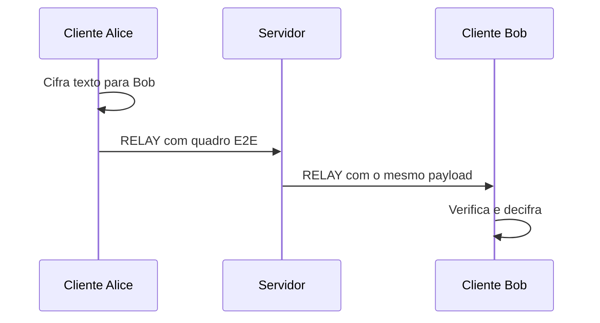
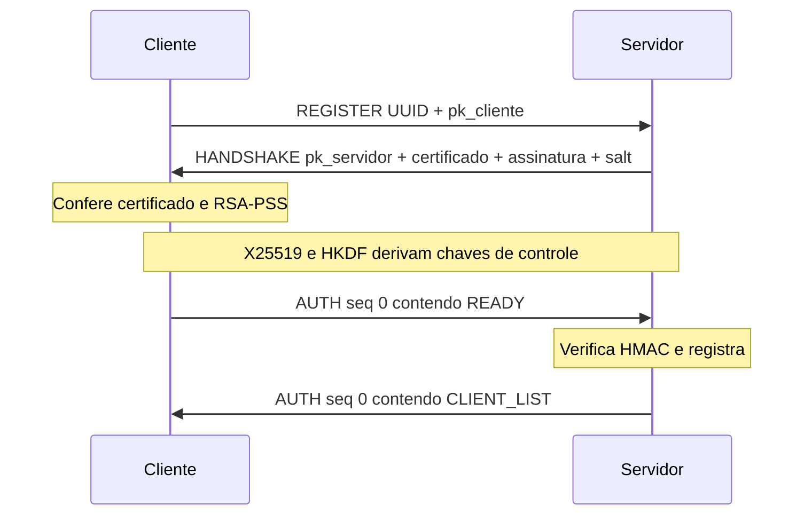

# Roteiro de apresentação e estudo — Dev A

Este roteiro acompanha a implementação atual. Em cada etapa, há uma **fala completa que você pode ler ou adaptar**, seguida do trecho de código correspondente. As indicações entre colchetes são ações na tela; não precisam ser lidas em voz alta. Os caminhos partem da raiz do repositório. Dev A apresenta servidor, sessões, relay, identidade RSA e handshake; Dev B aprofunda cliente e criptografia E2E.

Você não precisa memorizar nomes de funções ou números de linha. Entenda a sequência dos acontecimentos e use o código como apoio. As falas são deliberadamente mais longas que um resumo: elas explicam o motivo de cada mecanismo e fazem a passagem natural para a próxima parte.

> **Estado das evidências:** a suíte tinha 149 testes aprovados na verificação de 09/11/2026. Ainda não há um teste único que compare byte a byte o quadro E2E real na entrada e na saída do relay. Também falta um teste de rede que confirme nova conexão bem-sucedida após cada tipo de quadro inválido. Não apresente essas duas provas como concluídas.

## Mapa para abrir durante a fala

| Assunto | Arquivo e função |
| --- | --- |
| Arquitetura | [architecture.md](../architecture.md), diagrama e tabela |
| Entrada do servidor | [server/main.py](../../src/server/main.py), `iniciar_servidor` e `executar` |
| Identidade RSA | [crypto/identity.py](../../src/crypto/identity.py), `gerar_identidade`, `salvar_identidade`, `carregar_identidade` |
| Handshake e HMAC | [crypto/handshake.py](../../src/crypto/handshake.py), `transcricao`, `criar_handshake`, `validar_handshake`, `CanalAutenticado` |
| Ciclo da conexão | [server/connection.py](../../src/server/connection.py), `atender_cliente` |
| Sessões | [server/sessions.py](../../src/server/sessions.py), `Sessao` e `RegistroSessoes` |
| Relay | [server/relay.py](../../src/server/relay.py), `encaminhar` |
| Transporte e JSON | [common/framing.py](../../src/common/framing.py), [common/protocol.py](../../src/common/protocol.py) |
| Ponto de contato com Dev B | [client/messaging.py](../../src/client/messaging.py), `conectar`, `enviar_texto`, `_receber_relay` |

**Vocabulário:** `sk` é chave privada; `pk` é chave pública; `salt` é um valor público usado na derivação de chaves; `MAC` autentica dados; `E2E` significa ponta a ponta. Um UUID identifica uma sessão de cliente, não uma pessoa.

## 1. Introdução e arquitetura

### Fala completa — abertura

> “Olá. Vou começar mostrando a arquitetura e a parte pela qual fiquei responsável: o servidor e a entrada dos clientes no sistema.
>
> A ideia do projeto é permitir que duas ou mais pessoas troquem mensagens pelo terminal. Para isso, existe um servidor no meio da comunicação. Ele recebe as conexões, mantém uma lista de clientes online e entrega cada mensagem ao destinatário correto.
>
> A proteção do texto acontece nos clientes. Alice cifra a mensagem antes de enviá-la ao servidor. O servidor recebe o quadro já protegido e o encaminha a Bob. Bob verifica e decifra esse quadro. A isso chamamos criptografia ponta a ponta: o conteúdo original aparece nas extremidades da conversa.
>
> [Abra o diagrama de arquitetura.] Aqui, as setas mostram por onde os dados passam. O servidor participa do transporte e da distribuição de chaves públicas. Ele conhece algumas informações de funcionamento, como os identificadores dos clientes e o tamanho do quadro, mas não possui a chave usada para decifrar o texto da conversa.
>
> [Abra `src/server/main.py`.] Esta chamada inicia o servidor TCP. A função `atender_cliente` será executada para cada conexão. Depois de explicar como o servidor é preparado, vou acompanhar o caminho de um cliente desde a conexão até o envio de uma mensagem.”

**Mostre no código:**

1. [server/main.py](../../src/server/main.py), linhas 16–22: `asyncio.start_server` cria o serviço TCP e chama `atender_cliente` para cada conexão.
2. [server/relay.py](../../src/server/relay.py), linhas 6–24: o servidor escolhe o destino e repassa `payload`; não chama AES nem guarda chave E2E.
3. [client/messaging.py](../../src/client/messaging.py), linhas 130–141 e 206–227: `preparar_envio` cifra antes do relay; `processar_recebimento` decifra no destinatário.



**Explique:** o servidor ainda vê UUIDs, chaves públicas, tamanho e frequência aproximada. O controle administrativo é autenticado por HMAC, mas não é cifrado. E2E protege o conteúdo da conversa.

**Pergunta provável — O servidor é dispensável?** Não. Ele mantém o diretório de clientes online e transporta as mensagens.

### Trecho para apontar

```python
return await asyncio.start_server(
    partial(atender_cliente, sessoes=registro, identidade=identidade, salt=salt), endereco_servidor, porta
)
```

Leia assim: `asyncio.start_server` abre a escuta TCP; `atender_cliente` é a função chamada para cada nova conexão; `partial` entrega a ela o diretório, a identidade e o salt desta execução. É a passagem do processo principal para o tratamento de cada cliente, em [server/main.py](../../src/server/main.py).

## 2. Inicialização e identidade do servidor

### Fala completa — preparação da identidade

> “O primeiro cuidado acontece antes de alguém se conectar. O servidor precisa ter uma identidade criptográfica. Pense nela como uma forma de comprovar que a resposta inicial veio do servidor esperado.
>
> [Abra `scripts/generate_server_keys.py`.] Preparamos essa identidade com um comando executado uma vez. Ele cria uma chave RSA privada e um certificado digital. A chave privada fica guardada no servidor. O certificado contém a chave pública correspondente e pode ser entregue aos clientes.
>
> [Abra `src/crypto/identity.py`.] Aqui vemos a geração da chave e do certificado. O arquivo da chave privada é criado com acesso restrito e o programa recusa sobrescrever uma identidade que já existe. Isso evita trocar a identidade por acidente. O código também verifica se o certificado está válido e se corresponde à chave privada carregada.
>
> O certificado é autoassinado. Isso quer dizer que não usamos uma autoridade certificadora externa. A confiança vem de outro passo: antes da conexão, o cliente já recebe uma cópia confiável desse certificado. Durante o handshake, ele compara o certificado recebido pela rede com sua cópia. Se forem diferentes, a conexão falha.
>
> [Abra `src/server/main.py`.] Na inicialização, o servidor carrega essa identidade antes de abrir a porta TCP. Também cria um salt aleatório de 16 bytes para esta execução. O salt participa da derivação de chaves; ele não é uma senha e pode ser transmitido. Agora que o servidor está preparado, podemos ver como um cliente entra.”

**Mostre no código:**

1. [scripts/generate_server_keys.py](../../scripts/generate_server_keys.py), linhas 9–18: o comando de preparação chama `gerar_identidade` e `salvar_identidade`. Ele é executado uma vez, não a cada início do servidor.
2. [crypto/identity.py](../../src/crypto/identity.py), linhas 51–71: gera RSA de 3072 bits por padrão e certificado X.509 autoassinado válido por 365 dias. A **assinatura do certificado** usa SHA-256 e PKCS#1 v1.5; a **assinatura do handshake** usa RSA-PSS. São operações distintas.
3. No mesmo arquivo, linhas 74–92: `O_EXCL` impede sobrescrita e `0600` restringe o arquivo `secrets/server.key` no POSIX. O certificado fica em `certs/server.crt`. Nunca projete a chave privada.
4. Linhas 29–48 e 95–112: `validar_certificado` confere perfil, autoassinatura e vigência; `carregar_identidade` confirma correspondência entre chave e certificado.
5. [server/main.py](../../src/server/main.py), linhas 16–22 e 31–47: carrega identidade antes de escutar, gera `os.urandom(16)` uma vez por execução e oferece `--chave` e `--certificado`.
6. [crypto/handshake.py](../../src/crypto/handshake.py), linhas 129–132: o cliente compara o certificado recebido com a cópia provisionada. É o *pinning* da implementação.

**Explique:** um certificado autoassinado não é confiável apenas por estar assinado. A confiança vem da cópia provisionada previamente. O salt é público, muda quando o servidor reinicia e é comum aos clientes da mesma execução. Os pares X25519 mudam por conexão.

**Pergunta provável — Posso gerar nova identidade a cada demonstração?** Não é necessário. O gerador recusa sobrescrever arquivos; trocar o certificado exige provisionar a nova cópia aos clientes.

### Trechos para apontar

```python
identidade = identidade if identidade is not None else carregar_identidade()
salt = os.urandom(16)
```

Em [server/main.py](../../src/server/main.py), a identidade é carregada antes de abrir a porta. O salt é criado uma vez para aquela execução. Nos testes, a função recebe uma identidade temporária por parâmetro.

```python
if chave.resolve() == certificado.resolve() or chave.exists() or certificado.exists():
    raise ErroIdentidade("destino já existe; escolha novos caminhos para gerar a identidade")
descritor = os.open(chave, os.O_WRONLY | os.O_CREAT | os.O_EXCL, 0o600)
```

Em [crypto/identity.py](../../src/crypto/identity.py), a primeira condição recusa destino já ocupado; `O_EXCL` reforça a recusa mesmo se outro processo criar o arquivo no mesmo instante; `0o600` restringe a chave privada ao dono no POSIX. Entre essas linhas, a função também cria os diretórios e serializa a chave.

## 3. Handshake: REGISTER, HANDSHAKE e READY

### Fala completa — entrada de um cliente

> “Vamos acompanhar a entrada de Alice. Primeiro, o cliente abre a conexão TCP e envia `REGISTER`. Essa mensagem contém um identificador UUID, criado pelo próprio cliente, e uma chave pública X25519 temporária. UUID é um identificador aleatório da sessão; ele não prova quem é a pessoa.
>
> [Abra `src/server/connection.py` na leitura de `REGISTER`.] O servidor exige que essa seja a primeira mensagem. Ele valida o identificador e a chave pública. Se os dados forem válidos, gera sua própria chave X25519 temporária e prepara uma resposta chamada `HANDSHAKE`.
>
> [Abra `src/crypto/handshake.py` em `transcricao`.] Antes de assinar, o servidor reúne quatro elementos em uma ordem fixa: sua chave pública temporária, a chave pública do cliente, o UUID do cliente e o salt. Essa sequência tem 96 bytes. A assinatura RSA-PSS protege o vínculo entre esses valores. Se alguém alterar um deles durante o transporte, a verificação da assinatura não corresponderá.
>
> O cliente recebe a resposta. Primeiro confere se o certificado é exatamente o que ele já tinha recebido por um meio confiável. Depois usa a chave pública desse certificado para verificar a assinatura. Se qualquer dessas etapas falhar, ele não termina a conexão.
>
> Quando a resposta é válida, cliente e servidor calculam um segredo compartilhado com X25519. Eles usam esse segredo para criar chaves do canal administrativo. O cliente então envia `READY`, uma confirmação autenticada por HMAC. [Volte a `src/server/connection.py`.] Repare que o servidor só chama `registrar_cliente` depois de validar `READY`. Essa ordem impede anunciar como online alguém que não concluiu o handshake.
>
> Depois do registro, o servidor envia a lista inicial de outros clientes. É essa lista que permite a Alice descobrir a chave pública de Bob e iniciar a conversa protegida.”

**Percurso no código:**

1. [client/messaging.py](../../src/client/messaging.py), linhas 69–95: `conectar` renova o par X25519, abre TCP e chama `connection.registrar`, inclusive na reconexão da mesma instância.
2. [client/connection.py](../../src/client/connection.py), linhas 22–35: `registrar` envia `REGISTER` com `client_id` e `client_public_key` em Base64.
3. [server/connection.py](../../src/server/connection.py), linhas 38–50: `atender_cliente` exige `REGISTER`, valida UUID e chave e envia `HANDSHAKE`.
4. [crypto/handshake.py](../../src/crypto/handshake.py), linhas 43–48: `transcricao` concatena `pk_server[32] || pk_client[32] || client_id[16] || salt_srv[16]`, total de **96 bytes**, nesta ordem.
5. No mesmo arquivo, linhas 104–120: `criar_handshake` gera o par X25519 do servidor, calcula o segredo e assina `SHA256(transcricao)` com RSA-PSS, MGF1-SHA256 e salt PSS de 32 bytes. `Prehashed` evita um segundo hash. A resposta contém certificado, assinatura, chave efêmera e salt.
6. Linhas 123–144: `validar_handshake` confere versão e campos, compara o certificado com o provisionado, refaz a transcrição, verifica RSA-PSS e calcula o segredo X25519. Falha gera `ErroHandshake`.
7. [client/messaging.py](../../src/client/messaging.py), linhas 97–108: o cliente envia `READY` dentro de `AUTH`.
8. [server/connection.py](../../src/server/connection.py), linhas 51–68: o servidor exige `READY` válido **antes** de `registrar_cliente` e de enviar `CLIENT_LIST`. O handshake tem prazo de 10 segundos.



**Distinção:** X25519 cliente-servidor deriva chaves do **controle**. X25519 entre clientes deriva chaves **E2E**. RSA-PSS assina; não cifra o chat. `READY` prova posse da chave efêmera, mas não a identidade civil do usuário.

**Pergunta provável — O que impede trocar a chave efêmera do servidor?** Ela faz parte da transcrição assinada. Mudar chave, UUID, salt ou assinatura faz a verificação falhar.

### Trechos para apontar

```python
return chave_servidor + chave_cliente + UUID(id_cliente).bytes + salt
```

Em [crypto/handshake.py](../../src/crypto/handshake.py), esta é a transcrição exata: 32 + 32 + 16 + 16 = 96 bytes. A ordem importa porque ambos os lados precisam assinar/verificar o mesmo dado.

```python
assinatura = identidade.chave_privada.sign(
    hashlib.sha256(dados).digest(),
    padding.PSS(mgf=padding.MGF1(hashes.SHA256()), salt_length=32),
    utils.Prehashed(hashes.SHA256()),
)
```

O servidor assina o resumo da transcrição com sua chave RSA privada. No cliente, `confiavel.public_key().verify(...)` em `validar_handshake` verifica a assinatura com a chave pública do certificado previamente aceito. O salt PSS de 32 bytes pertence à assinatura; não é o `salt_srv` de 16 bytes transmitido no handshake.

```python
if dados is None or canal.desempacotar(decodificar_mensagem(dados)) != {"type": "READY"}:
    raise ErroProtocolo("confirmação do handshake ausente ou inválida")
```

Em [server/connection.py](../../src/server/connection.py), `desempacotar` verifica sessão, sequência e HMAC antes de devolver `READY`. O registro da sessão aparece somente abaixo desse bloco.

## 4. Canal administrativo autenticado

### Fala completa — proteção das mensagens de controle

> “Depois do handshake, ainda precisamos proteger as mensagens usadas para administrar a conexão. Um exemplo é a lista de participantes e suas chaves públicas. Se alguém conseguisse trocar uma chave nessa lista, o cliente poderia cifrar uma mensagem para a pessoa errada.
>
> Para evitar isso, cliente e servidor criam duas chaves de controle a partir do segredo X25519 que acabaram de estabelecer: uma para mensagens que vão do cliente ao servidor e outra para o caminho inverso. Elas são diferentes das chaves usadas na conversa entre Alice e Bob.
>
> [Abra `CanalAutenticado` em `src/crypto/handshake.py`.] Cada mensagem administrativa vai em um envelope chamado `AUTH`. Além da mensagem, ele contém a identificação da sessão, um número de sequência e um HMAC. O HMAC funciona como uma marca que apenas os lados com a chave correta conseguem calcular.
>
> Quando o envelope chega, o receptor verifica se pertence à sessão certa, se tem o próximo número esperado e se o HMAC é válido. O contador só avança depois dessas verificações. Assim, alterar a lista de clientes ou repetir um comando antigo faz a mensagem ser recusada.
>
> É importante delimitar essa proteção: o HMAC autentica os dados, mas não os esconde. Os metadados administrativos continuam visíveis. A confidencialidade do texto da conversa é responsabilidade da camada ponta a ponta, que o Dev B vai detalhar.”

**Mostre no código:**

1. [crypto/handshake.py](../../src/crypto/handshake.py), linhas 94–101: `_criar_canal` deriva 64 bytes via HKDF-SHA256 do segredo X25519; 32 bytes servem cliente → servidor e 32, servidor → cliente. `SHA256(transcricao)` vincula as chaves ao handshake.
2. Linhas 51–55: `_canonico` produz JSON estável para o HMAC, independente dos espaços do JSON externo.
3. Linhas 58–91: `CanalAutenticado.empacotar` inclui `session_id`, `seq_no`, `message` e `mac`; `desempacotar` exige próximo número e usa `compare_digest`. O contador de recebimento só avança após MAC válido.
4. [server/connection.py](../../src/server/connection.py), linhas 16–24 e 70–77: `enviar` autentica eventos e ordena escritas; o recebimento chama `canal.desempacotar`.

**Explique:** HMAC garante autenticidade e integridade dentro da sessão, mas não confidencialidade. O contador de `AUTH` é independente do contador E2E das conversas.

**Pergunta provável — Por que contadores por direção?** Envio e recebimento avançam independentemente; uma direção não altera a sequência esperada da outra.

### Trecho para apontar

```python
if type(seq) is not int or not 0 <= seq <= MAX_SEQUENCIA or seq != self.seq_recebimento:
    raise ErroHandshake("sequência administrativa inválida ou repetida")
esperado = hmac.digest(self.chave_recebimento, _canonico(autenticado), "sha256")
if not hmac.compare_digest(esperado, de_base64(envelope["mac"], 32)):
    raise ErroHandshake("autenticação administrativa inválida")
self.seq_recebimento += 1
```

Este excerto reúne as verificações de [crypto/handshake.py](../../src/crypto/handshake.py), `CanalAutenticado.desempacotar`. Há algumas linhas entre as condições no arquivo original: elas validam o formato da mensagem e montam `autenticado` sem o campo `mac`. O ponto para explicar é que o contador só sobe **depois** de confirmar o HMAC.

## 5. Sessões e diretório de chaves

### Fala completa — quem está online

> “Agora que Alice provou que concluiu o handshake, o servidor pode tratá-la como cliente ativo. Para isso, ele cria uma sessão. Sessão, neste projeto, é o registro da conexão atual: identificador UUID, chave pública do cliente, conexão TCP e canal administrativo.
>
> [Abra `src/server/sessions.py`.] O servidor guarda essas sessões em um dicionário. Assim ele consegue localizar Bob pelo UUID quando Alice envia uma mensagem. Ele também evita que duas conexões ativas usem o mesmo identificador e impõe um limite de 128 clientes registrados.
>
> [Abra `src/server/connection.py` no bloco `async with sessoes.trava`.] Quando alguém entra, o servidor primeiro consulta os participantes existentes, registra o novo cliente e envia a ele a lista inicial. Em seguida avisa os demais que houve uma entrada. Quando alguém sai ou a conexão termina, o servidor remove a sessão e avisa os participantes restantes.
>
> A trava que aparece aqui organiza essas operações quando vários clientes se conectam quase ao mesmo tempo. Há também uma trava em cada sessão para manter a ordem das mensagens enviadas a ela e dos contadores do canal administrativo.
>
> Uma distinção importante: a sessão do servidor guarda a chave **pública** de Alice, mas não guarda as chaves AES usadas na conversa entre Alice e Bob. Essas chaves são calculadas nos clientes.”

**Mostre no código:**

1. [server/sessions.py](../../src/server/sessions.py), linhas 9–22: `Sessao` guarda `id_cliente`, `chave_publica`, `escritor` e `canal`. **Não guarda chave AES E2E nem segredo X25519 entre clientes.** `RegistroSessoes` tem dicionário e `asyncio.Lock`.
2. Linhas 24–45: `registrar_cliente` recusa UUID duplicado e limita a 128 sessões; `obter_cliente` consulta o destino; `remover_cliente` confere a conexão; `listar_clientes` retorna a lista atual.
3. [server/connection.py](../../src/server/connection.py), linhas 56–68: sob `sessoes.trava`, o servidor registra, envia `CLIENT_LIST` ao novo cliente e `CLIENT_JOINED` aos anteriores.
4. Linhas 82–94: o bloco `finally` remove a sessão e envia `CLIENT_LEFT`. `avisar`, linhas 26–33, trata falha de um participante sem impedir os demais avisos.
5. Linhas 16–24: `sessao.trava_envio` ordena envelopes, escritas e contadores do mesmo destinatário.

**Explique:** o UUIDv4 nasce no cliente, em [client/messaging.py](../../src/client/messaging.py), linha 49. O servidor valida esse valor; não cria uma identidade civil. As chaves públicas dos peers chegam aos clientes pelo canal administrativo autenticado.

**Pergunta provável — E se dois clientes entrarem juntos?** A trava serializa lista, entrada e saída. O teste `testar_registros_simultaneos_preservam_lista_e_eventos` confere a visão final dos clientes.

### Trechos para apontar

```python
if id_cliente in self._sessoes:
    raise ValueError("identificador já conectado")
if len(self._sessoes) >= self.limite:
    raise ValueError("limite de clientes atingido")
```

Em [server/sessions.py](../../src/server/sessions.py), o dicionário de sessões impede UUID repetido e aplica o limite de 128 clientes.

```python
async with sessoes.trava:
    participantes = sessoes.listar_clientes()
    sessao = sessoes.registrar_cliente(id_cliente, registro["client_public_key"], escritor, canal)
    await enviar(sessao, {
        "type": "CLIENT_LIST",
        "clients": [{"client_id": participante.id_cliente, "client_public_key": participante.chave_publica} for participante in participantes],
    })
```

Em [server/connection.py](../../src/server/connection.py), a trava envolve a leitura da lista, o registro e o envio inicial. O bloco continua com `CLIENT_JOINED` aos participantes anteriores. Assim, entrada e lista seguem uma ordem coerente mesmo com conexões simultâneas.

## 6. Relay e conteúdo opaco

### Fala completa — entrega sem decifrar

> “Com Alice e Bob conectados, podemos ver a função principal do servidor durante a conversa: encaminhar.
>
> [Abra `enviar_texto` em `src/client/messaging.py`.] Quando Alice digita uma mensagem, o cliente a transforma em um quadro cifrado. Esse quadro segue dentro do campo `payload` de um pedido `RELAY`. A cifragem ocorre antes de o servidor receber o pedido.
>
> [Abra `encaminhar` em `src/server/relay.py`.] O servidor recebe o pedido em uma sessão autenticada. Ele verifica o identificador do destinatário, confere se o `payload` tem um formato e tamanho permitidos e procura a conexão de Bob. Depois envia a Bob o mesmo campo `payload`. O identificador do remetente que ele acrescenta vem da sessão autenticada de Alice, não de um texto que Alice poderia inventar no pedido.
>
> [Aponte `mensagem[\"payload\"]` na saída.] Esta linha é central: o conteúdo E2E é repassado sem chamada de decifragem. O servidor não tem as chaves da conversa. Ele registra apenas origem, destino e quantidade de bytes. Bob, ao receber o quadro, verifica e decifra em seu próprio cliente.
>
> Se Bob já tiver saído ou a escrita para ele falhar, o servidor envia `UNKNOWN_CLIENT` para Alice. Esse problema não encerra a conexão dela; ela pode continuar falando com outros clientes.
>
> Vale uma precisão: o `payload` E2E é preservado, mas a mensagem TCP/JSON externa muda, porque o servidor acrescenta o remetente e cria um novo envelope administrativo para Bob.”

**Percurso no código:**

1. [client/messaging.py](../../src/client/messaging.py), linhas 130–141: `enviar_texto` chama `preparar_envio` e passa o quadro cifrado ao relay.
2. [client/connection.py](../../src/client/connection.py), linhas 46–55: o quadro E2E entra como `payload` Base64 em `RELAY`.
3. [server/connection.py](../../src/server/connection.py), linhas 70–79: o servidor verifica `AUTH` e passa a **sessão do remetente** a `encaminhar`; não confia em `sender_id` fornecido por ele.
4. [server/relay.py](../../src/server/relay.py), linhas 6–19: `decodificar_conteudo` verifica Base64 e tamanho; `obter_cliente` localiza B; a saída usa `mensagem["payload"]` sem alterar seu conteúdo.
5. Linhas 12–24: destino ausente ou escrita falha envia `ERROR UNKNOWN_CLIENT`; o log mostra UUIDs e quantidade de bytes, sem texto.
6. [client/messaging.py](../../src/client/messaging.py), linhas 206–227: B confere IDs, chama `processar_recebimento` e só publica `mensagem` após autenticar e decifrar.

**Nuance:** “mesmo payload” significa os mesmos bytes do **quadro E2E** após decodificar Base64. O quadro TCP/JSON externo muda, pois o servidor acrescenta `sender_id` e cria outro envelope HMAC. Não diga que o pacote TCP inteiro sai idêntico.

**Evidência atual:** [test_initial_server.py](../../tests/test_initial_server.py), `testar_registro_encaminhamento_e_desconexao`, compara o campo `payload` antes e depois usando bytes opacos de teste. [test_integration.py](../../tests/test_integration.py), `testar_dois_clientes_trocam_mensagens_e2e`, observa o quadro cifrado no servidor e a recuperação do texto em B. **Ainda falta uma asserção única de igualdade byte a byte entre entrada e saída para um quadro E2E real.**

**Pergunta provável — Um servidor comprometido poderia interferir?** Sim. O servidor é autoridade do diretório de chaves públicas. Com a identidade RSA comprometida, poderia substituir chaves. Resistir a isso exigiria autenticação independente das chaves dos usuários.

### Trecho para apontar

```python
conteudo = decodificar_conteudo(mensagem.get("payload"))
destinatario = sessoes.obter_cliente(id_destinatario)
await enviar(destinatario, {
    "type": "RELAY", "sender_id": remetente.id_cliente,
    "recipient_id": id_destinatario, "payload": mensagem["payload"],
})
```

Este excerto de [server/relay.py](../../src/server/relay.py) omite o tratamento de destino ausente e a proteção contra falha de escrita, que estão entre essas linhas no arquivo. `decodificar_conteudo` valida Base64 e tamanho; `obter_cliente` encontra B; `payload` é copiado sem decifrar. `remetente.id_cliente` vem da sessão autenticada, não de um campo controlado por A.

## 7. TCP, framing, JSON e erros

### Fala completa — limites do transporte

> “Até aqui eu falei em ‘mensagens’, mas a conexão TCP não entrega mensagens prontas. Ela entrega um fluxo de bytes. Um envio pode chegar em pedaços, ou dois envios podem chegar juntos. O programa precisa saber onde cada quadro começa e termina.
>
> [Abra `src/common/framing.py`.] Nossa regra é colocar quatro bytes antes de cada corpo. Esses bytes informam o tamanho do corpo em ordem big endian. O leitor espera exatamente quatro bytes, interpreta o tamanho, verifica se está dentro do limite de 64 KiB e só então lê o corpo inteiro.
>
> Se o comprimento for zero ou maior que o limite, o quadro é rejeitado. Se a conexão fechar antes de terminar o cabeçalho ou o corpo, a leitura também gera um erro controlado. O handler do servidor trata esse erro e fecha aquela conexão.
>
> [Abra `src/common/protocol.py`.] Depois que o corpo chega completo, ainda é preciso validar o JSON. O código recusa campos repetidos, valores não finitos, UUIDs fora do formato esperado, chaves públicas de tamanho errado e `payload` acima do limite E2E.
>
> Esses cuidados não tornam o sistema imune a todo ataque de negação de serviço, mas evitam aceitar quadros com comprimento arbitrário ou dados malformados como se fossem mensagens válidas. Durante o handshake há prazo de dez segundos; depois do registro não há um prazo geral para toda leitura.”

**Mostre no código:**

1. [common/framing.py](../../src/common/framing.py), linhas 5 e 12–32: limite externo de **64 KiB**; `readexactly(4)` lê o comprimento e `readexactly(tamanho)` lê o corpo; `escrever_quadro` prefixa o tamanho.
2. [common/protocol.py](../../src/common/protocol.py), linhas 15–26 e 63–73: JSON UTF-8, rejeição de chaves repetidas e constantes não finitas.
3. Linhas 29–60: UUIDv4 canônico, chave pública de 32 bytes em Base64 e `payload` de 1 a **4.164 bytes**. Limite interno E2E e limite externo TCP são distintos.
4. [server/connection.py](../../src/server/connection.py), linhas 38–54 e 70–94: o handler trata `ErroQuadro` e `ErroProtocolo`, fecha a conexão problemática e limpa sua sessão.

**Explique:** um quadro incompleto só é identificado após fechamento/falha da leitura. Enquanto a conexão fica aberta, o leitor espera. Há timeout de 10 segundos durante o handshake; não há prazo geral de leitura após o registro. Não diga que todo cliente lento é encerrado automaticamente.

**Testes:** [test_framing.py](../../tests/test_framing.py) cobre fragmentação, quadros juntos, cabeçalho/corpo incompletos e limites. [test_initial_server.py](../../tests/test_initial_server.py) cobre tamanho excessivo pela rede. **Ainda não existe teste de rede para cada quadro inválido seguido de reconexão bem-sucedida.**

### Trecho para apontar

```python
cabecalho = await leitor.readexactly(4)
tamanho = int.from_bytes(cabecalho, "big")
if not 0 < tamanho <= TAMANHO_MAXIMO_QUADRO:
    raise ErroQuadro("invalid frame length")
return await leitor.readexactly(tamanho)
```

Este excerto de [common/framing.py](../../src/common/framing.py) omite os blocos `try/except` que convertem leitura incompleta em `ErroQuadro`. Primeiro lê exatamente quatro bytes; interpreta o inteiro em big endian; valida o limite; só então lê o corpo completo. O limite externo é definido em `TAMANHO_MAXIMO_QUADRO = 64 * 1024`.

## 8. Demonstração prática

### Fala completa — apresentação ao vivo

> “Agora vou mostrar o sistema funcionando. Vamos usar três terminais: um para o servidor, outro para Alice e outro para Bob. Todos executam o mesmo projeto; apenas iniciamos processos diferentes.
>
> [Inicie o servidor.] Esta linha confirma que ele abriu a porta TCP. Como a identidade foi carregada antes da escuta, uma chave ou certificado ausente impediria essa inicialização.
>
> [Inicie Alice e Bob.] Cada cliente faz o registro, confere o certificado do servidor, valida o handshake e só então recebe a lista de participantes. Vamos usar `/id` para ver o UUID e `/peers` para mostrar que um cliente conhece o outro. A impressão digital exibida é um resumo curto da chave pública, útil para reconhecê-la na demonstração.
>
> [Envie a mensagem de Alice.] Alice vai escrever ‘mensagem confidencial’ para Bob. Bob recebe o texto original no terminal. No terminal do servidor aparece apenas uma linha com origem, destino e número de bytes. Essa tela ajuda a mostrar o papel do relay, mas a ausência de texto no log, sozinha, não prova toda a segurança criptográfica; por isso também apresentaremos os testes.
>
> [Responda como Bob.] Agora a mensagem percorre o sentido contrário, com chaves e contadores próprios para essa direção.
>
> [Encerre Bob com `/sair`.] Alice recebe o aviso de saída. Se eu iniciar Bob de novo, acontece um novo registro e uma nova chave pública efêmera. Isso evita reaproveitar a chave da conexão anterior.
>
> Com a troca nos dois sentidos e a remoção da sessão demonstradas, vou mostrar os testes que verificam as rejeições de dados inválidos.”

Na raiz do repositório, prepare o ambiente. **Execute o gerador apenas se a identidade ainda não existir.**

```sh
python3 -m venv .venv
.venv/bin/python -m pip install -r requirements.txt
.venv/bin/python -m scripts.generate_server_keys
```

Abra três terminais, todos na raiz:

```sh
# Terminal 1: servidor
.venv/bin/python -m src.server.main
```

```sh
# Terminal 2: Alice
.venv/bin/python -m src.client.main
```

```sh
# Terminal 3: Bob
.venv/bin/python -m src.client.main
```

1. Em Alice e Bob, use `/id` para mostrar UUID e impressão digital da chave pública.
2. Use `/peers` nos dois clientes para mostrar o outro participante.
3. Em Alice: `/msg <UUID-ou-prefixo-único-de-Bob> mensagem confidencial`.
4. Em Bob, mostre o texto recebido e responda com `/msg <UUID-ou-prefixo-único-de-Alice> resposta do Bob`.
5. No servidor, mostre `Relay: origem=... destino=... bytes=...`. O log contém metadados, sem texto.
6. Use `/sair` em Bob. Alice deve informar que ele saiu. Abra Bob de novo e mostre novo registro e nova chave pública.
7. Encerre clientes com `/sair` e servidor com `Ctrl+C`.

**Máquinas diferentes:** configure `--host` e `--port` e passe `--certificado CAMINHO` aos clientes. Copie **somente** o certificado do servidor por meio confiável. `127.0.0.1` serve apenas à máquina local.

## 9. Evidências e testes para mostrar

### Fala completa — validação

> “A demonstração normal mostrou que duas pessoas conseguem conversar. Os testes automatizados verificam também o que acontece quando algo dá errado. Vou executar a suíte completa e depois abrir alguns cenários específicos no código.
>
> [Execute `pytest -q`.] Cada ponto representa um caso aprovado. O resultado total nos informa que as asserções desses testes passaram nesta execução. Isso não equivale a uma auditoria formal de segurança; mostra o comportamento dos casos que escrevemos.
>
> [Abra o teste de certificado errado.] Aqui o cliente tenta se conectar confiando em outro certificado. O teste exige que a conexão falhe e que o diretório do servidor continue vazio. Isso mostra que não basta um servidor qualquer apresentar uma assinatura válida com sua própria chave.
>
> [Abra o teste de handshake adulterado.] O teste altera assinatura, chave pública ou salt. Em todos esses casos, o cliente rejeita a resposta e não conclui o registro.
>
> [Passe ao teste de replay E2E.] O mesmo quadro cifrado é entregue duas vezes. A primeira entrega produz uma mensagem válida. A segunda produz rejeição por repetição. O teste ainda envia uma nova mensagem válida para confirmar que a conversa pode continuar.
>
> [Mostre o teste de adulteração.] Quando um byte do ciphertext muda, Bob publica um evento de mensagem rejeitada e o contador de recebimento não avança. No código do cliente, uma tag AES-GCM inválida leva ao erro de autenticação.
>
> [Mostre os testes de framing.] Eles verificam quadros fragmentados, incompletos ou acima do limite. O comportamento esperado é rejeitar os dados problemáticos de forma controlada.
>
> Há duas evidências que ainda podemos reforçar com testes novos: comparar, em um mesmo caso, os bytes E2E reais antes e depois do relay; e testar uma nova conexão após cada tipo de quadro inválido. Por isso, se for perguntado, vou separar o que o código implementa do que já foi provado por uma asserção específica.”

```sh
.venv/bin/python -m pytest -q
.venv/bin/python -m pytest -v tests/test_server_handshake.py tests/test_integration.py
.venv/bin/python -m pytest -v tests/test_framing.py tests/test_initial_server.py
```

Testes de rede precisam abrir sockets TCP locais. Os testes geram uma identidade temporária própria; não usam a chave privada da demonstração.

| Assunto | Teste | Asserção principal |
| --- | --- | --- |
| Certificado errado | [test_server_handshake.py](../../tests/test_server_handshake.py), `testar_certificado_errado_impede_registro` | `Cliente.conectar` falha e diretório fica vazio. |
| Assinatura, chave ou salt alterado | Mesmo arquivo, `testar_handshake_adulterado_na_rede_fecha_cliente` | `ErroHandshake` e nenhuma sessão registrada. |
| Registro após prova | Mesmo arquivo, `testar_registro_nao_aparece_antes_da_prova_de_posse` | `REGISTER` sozinho não torna o cliente visível. |
| Lista autenticada | Mesmo arquivo, `testar_lista_de_chaves_adulterada_apos_mac_e_recusada` | Alterar `CLIENT_LIST` sem refazer HMAC impede a conexão. |
| Replay administrativo | Mesmo arquivo, testes com “replay” no nome | Repetir `AUTH` viola sequência administrativa. |
| Troca E2E | [test_integration.py](../../tests/test_integration.py), `testar_dois_clientes_trocam_mensagens_e2e` | Dois clientes recuperam textos; o quadro observado no servidor não contém texto claro. |
| Adulteração do ciphertext | Mesmo arquivo, `testar_bitflip_pela_rede_e_rejeitado[cifrado]` | B publica `rejeitada` e contador E2E não avança. A asserção não exige o motivo textual “authentication failed”. |
| Replay E2E | Mesmo arquivo, `testar_replay_pela_rede_e_rejeitado` | Primeira entrega aceita, repetição rejeitada, próxima mensagem válida aceita. |
| Quadros inválidos | [test_framing.py](../../tests/test_framing.py), [test_initial_server.py](../../tests/test_initial_server.py) | Leitor rejeita comprimentos e truncamentos; servidor fecha conexão com tamanho excessivo. |

**Não confunda:** replay administrativo usa HMAC e contador de `AUTH`; replay E2E usa sequência do quadro de conversa em [client/peers.py](../../src/client/peers.py). Para demonstrar E2E, abra o teste de integração.

## 10. Perguntas difíceis e respostas curtas

**O certificado autoassinado é seguro por si só?** Não. O cliente exige a cópia confiável provisionada antes da conexão. Não há autoridade certificadora externa.

**O que o servidor vê?** UUIDs, chaves públicas, tamanhos e frequência aproximada. Não recebe chaves AES E2E nem texto claro na operação normal. O controle administrativo é autenticado, mas não cifrado.

**E se o servidor estiver comprometido?** Pode substituir chaves públicas do diretório se controlar a identidade RSA. O projeto confia no servidor como autoridade desse diretório.

**O que diferencia RSA-PSS, HMAC e AES-GCM?** RSA-PSS assina o handshake; HMAC autentica o controle; AES-GCM cifra e autentica o texto entre clientes. Cada mecanismo tem finalidade e chaves próprias.

**O servidor guarda o segredo X25519 entre Alice e Bob?** Não. Os clientes calculam esse segredo localmente com chave privada própria e chave pública do peer. O segredo X25519 cliente-servidor deriva apenas chaves de controle.

**O salt precisa ser secreto?** Não. Nesta implementação ele é público e novo a cada execução do servidor. A reconexão também gera novos pares X25519.

**O UUID prova quem é a pessoa?** Não. Identifica uma sessão; não há cadastro nem identidade civil.

**Como comprovar confidencialidade?** Mostre onde A cifra, onde o relay repassa `payload`, onde B decifra e o teste que confirma que o texto não aparece no quadro visto pelo servidor. Seja preciso sobre a comparação byte a byte ainda ausente.

**Quais escolhas dependiam do professor?** Leia [relatorio-progresso-dev-a.md](../relatorio-progresso-dev-a.md). Elas foram assumidas e documentadas sem resposta. O PDF original não está neste checkout; a comparação usa requisitos transcritos no repositório.

## 11. Encerramento da apresentação

### Fala completa — conclusão e passagem ao Dev B

> “Para concluir minha parte: o servidor começa carregando uma identidade RSA e só aceita um cliente no diretório depois do handshake e do `READY` autenticado. Ele organiza as sessões, distribui as chaves públicas dos clientes online e encaminha o `payload` cifrado ao destino. O enquadramento TCP e as validações de protocolo impedem que dados fora do formato esperado sejam tratados como mensagens válidas.
>
> O ponto que quero destacar é a separação de responsabilidades. Minha parte garante a entrada autenticada no servidor, a ordem dos eventos e o transporte até o destinatário. A parte do Dev B explica como os clientes calculam as chaves entre si, cifram o texto com AES-GCM e rejeitam adulteração ou replay E2E.
>
> Os testes e a demonstração dão evidência dos comportamentos implementados. Também documentamos os limites: o servidor vê metadados e é a autoridade confiável do diretório de chaves; o projeto não identifica civilmente os usuários e não foi submetido a uma auditoria criptográfica formal. Com isso, passo ao Dev B para detalhar a criptografia das mensagens entre os clientes.”

Se o Dev B já tiver apresentado a parte E2E antes, substitua a última frase por: “Com isso, encerramos a demonstração das partes integradas do sistema.”

## 12. Ensaio antes de apresentar

- Explique sem ler: `REGISTER → HANDSHAKE → READY → CLIENT_LIST → RELAY → CLIENT_LEFT`.
- Aponte `registrar_cliente` no instante **após** `READY` válido.
- Diferencie a chave que assina, a que verifica, a que autentica controle e a que cifra E2E.
- Distinga o `payload` E2E do envelope TCP/JSON/HMAC externo.
- Execute a demonstração e os testes de handshake, replay E2E e framing.
- Nunca mostre `secrets/server.key`, chaves privadas ou dumps de memória.

O roteiro está pronto para o ensaio quando você consegue acompanhar cada fala com o trecho indicado e responder às perguntas acima.
