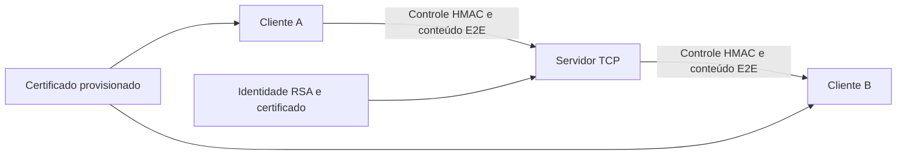

# Arquitetura implementada

O Dev A mantém o servidor, as sessões, o relay e a identidade RSA. O Dev B mantém o cliente, a interface e a criptografia E2E. A integração autentica o controle sem disponibilizar ao servidor as chaves das conversas.

## Responsabilidade dos módulos

| Módulo | Responsabilidade |
| --- | --- |
| `common/framing.py` | Quadros TCP completos e limites de comprimento. |
| `common/protocol.py` | JSON e validação dos campos públicos. |
| `common/constants.py` | Tamanhos compartilhados do quadro E2E. |
| `crypto/identity.py` | Gerar, salvar e carregar a identidade; validar certificado. |
| `crypto/handshake.py` | Assinar/verificar X25519 com RSA-PSS; derivar e verificar canais HMAC. |
| `crypto/key_derivation.py` | X25519 e HKDF das conversas E2E. |
| `crypto/aead.py` | AES-128-GCM, AAD, nonce e quadro E2E. |
| `server/main.py` | Identidade, salt por execução, opções CLI e servidor TCP. |
| `server/connection.py` | Handshake, registro efetivo, listas, eventos e limpeza. |
| `server/sessions.py` | Sessões, canais, limite e ordenação de mudanças do diretório. |
| `server/relay.py` | Roteamento opaco, erro recuperável e logs de metadados. |
| `client/connection.py` | TCP, framing e envelopes. |
| `client/messaging.py` | Handshake, peers, envio e eventos da aplicação. |
| `client/peers.py` | Chaves direcionais, contadores e proteção contra replay E2E. |
| `client/main.py` | Comandos e apresentação das mensagens no terminal. |

## Estado e ciclo de vida

O servidor guarda a identidade RSA persistente e o salt desta execução. Cada sessão guarda UUID, chave pública do cliente, conexão, canal administrativo e trava de envio. A chave efêmera do servidor serve ao handshake dessa conexão; as chaves derivadas de controle permanecem durante a sessão.

O cliente guarda a sua chave privada efêmera, o certificado confiável e o canal com o servidor. Cada peer possui chaves AES de envio/recebimento, sequências e IV bases. Fechar limpa as referências desse estado; Python não garante apagamento físico imediato de objetos na memória.

Uma conexão começa sem registro, passa pelo handshake e envia uma prova `READY`. Depois de verificar essa prova, o servidor a adiciona ao diretório. Uma trava ordena os eventos de registro e saída, e cada sessão tem uma trava para ordenar escritas e contadores.

As assinaturas autenticam a identidade do servidor. HMAC protege o controle de ambos os sentidos. AES-GCM protege o conteúdo entre os clientes. Esses mecanismos têm chaves e contadores separados. Os limites de confiança e os bytes exatos estão em [protocol.md](protocol.md).
