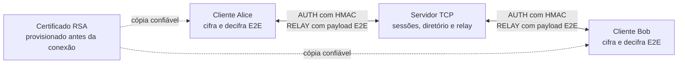

# Diagramas e modelos para a apresentação

Este é o **único arquivo de diagramas** para abrir durante a exposição. Siga as seções 1, 2 e 3; a seção 4 serve para perguntas sobre os bytes do protocolo. Os desenhos representam a implementação atual, não uma proposta futura. O roteiro de fala pessoal do Dev A fica em `docs/anotacoes/`.

| Ordem | Mostre | Frase central |
| --- | --- | --- |
| 1 | Arquitetura | O servidor gerencia conexões e entrega quadros; os clientes protegem o texto. |
| 2 | Entrada e saída de clientes | O registro só ocorre depois de `READY` autenticado. |
| 3 | Caminho da mensagem | O `payload` E2E é encaminhado sem decifragem no servidor. |
| 4, se perguntarem | Formatos e chaves | RSA-PSS, HMAC e AES-GCM têm funções e chaves distintas. |

## 1. Arquitetura e limite de confiança



**O que dizer:** Alice cifra no próprio cliente. O servidor identifica o destino e transporta o quadro. Bob verifica e decifra. O servidor possui a identidade RSA e o diretório das **chaves públicas**, mas não recebe as chaves AES E2E dos pares. A cópia confiável do certificado impede aceitar automaticamente um servidor que apresente outro certificado.

**Limite:** o servidor vê UUIDs, chaves públicas, tamanhos e eventos. O controle HMAC é autenticado, mas não cifrado. Um servidor comprometido que controle a identidade RSA e o diretório pode substituir chaves públicas; o projeto confia nele como autoridade do diretório. UUID não comprova identidade civil.

**Código correspondente:** [server/main.py](../src/server/main.py), [server/sessions.py](../src/server/sessions.py), [server/relay.py](../src/server/relay.py), [client/messaging.py](../src/client/messaging.py).

## 2. Entrada, registro e saída de um cliente

```mermaid
sequenceDiagram
    participant C as Cliente
    participant S as Servidor
    C->>S: REGISTER UUID + chave X25519 do cliente
    S->>C: HANDSHAKE chave X25519 do servidor + certificado + assinatura + salt
    Note over C: Confere certificado provisionado e assinatura RSA-PSS
    Note over C,S: X25519 e HKDF criam chaves HMAC do controle
    C->>S: AUTH com READY e sequência 0
    Note over S: Verifica HMAC; só agora registra a sessão
    S->>C: AUTH com CLIENT_LIST e sequência 0
    S-->>C: Avisos CLIENT_JOINED e CLIENT_LEFT de outros clientes
    C->>S: Fecha a conexão TCP
    Note over S: Remove a sessão e avisa os demais com CLIENT_LEFT
```

**O que dizer:** `REGISTER` sozinho não põe o cliente na lista. O servidor assina a chave efêmera e os dados do registro. O cliente confere o certificado que já tinha e a assinatura. Ambos derivam chaves do controle. O `READY` autenticado prova que o cliente concluiu esse acordo; depois dele vem `CLIENT_LIST`. Ao fechar o TCP, a sessão sai do diretório.

**Modelagem da transcrição assinada:**

```text
T = pk_servidor_X25519[32] || pk_cliente_X25519[32] || UUID_cliente[16] || salt_servidor[16]
len(T) = 96 bytes
assinatura = RSA-PSS(chave_RSA_privada_do_servidor, SHA256(T))
```

O salt do servidor tem 16 bytes e é público; muda a cada execução do servidor. Ele é diferente do salt interno de 32 bytes usado pela assinatura RSA-PSS. A chave X25519 do servidor é nova por conexão. A chave RSA de identidade é persistente.

**Código correspondente:** [server/connection.py](../src/server/connection.py) em `atender_cliente`; [crypto/handshake.py](../src/crypto/handshake.py) em `transcricao`, `criar_handshake` e `validar_handshake`; [crypto/identity.py](../src/crypto/identity.py).

## 3. Sessões e percurso de uma mensagem

```mermaid
sequenceDiagram
    participant A as Cliente Alice
    participant S as Servidor relay
    participant B as Cliente Bob
    Note over A,B: Ambos estão no diretório após o handshake
    A->>A: Cifra texto com chave E2E do par Alice/Bob
    A->>S: AUTH com RELAY(destino Bob, payload cifrado)
    Note over S: Confere HMAC, destino, Base64 e tamanho
    S->>B: AUTH com RELAY(origem Alice, mesmo payload)
    B->>B: Confere IDs, sequência e tag AES-GCM; decifra
    B-->>B: Exibe o texto original
```

**O que dizer:** o servidor obtém a origem da sessão autenticada, busca o destino no diretório e copia o mesmo campo `payload`. Bob verifica e decifra. O **quadro E2E** é preservado; o quadro TCP/JSON externo muda porque o servidor acrescenta `sender_id` e cria outro envelope HMAC. Se Bob não estiver online, o servidor responde `UNKNOWN_CLIENT` sem encerrar Alice.

**Estado mínimo de uma sessão no servidor:**

| Guardado pelo servidor | Finalidade |
| --- | --- |
| `id_cliente` (UUID) | Identificar a conexão e o remetente. |
| `chave_publica` X25519 | Distribuir aos outros clientes pelo canal autenticado. |
| `escritor` TCP | Enviar lista, avisos e quadros ao cliente. |
| `canal` HMAC e trava de envio | Autenticar e ordenar mensagens administrativas. |

As chaves AES E2E e os contadores E2E ficam nos clientes. O servidor valida Base64 e comprimento do `payload`, mas não decifra o quadro interno.

**Código correspondente:** [server/sessions.py](../src/server/sessions.py) em `Sessao` e `RegistroSessoes`; [server/relay.py](../src/server/relay.py) em `encaminhar`; [client/messaging.py](../src/client/messaging.py) em `enviar_texto` e `_receber_relay`.

## 4. Formatos e chaves — apoio para perguntas

### Camadas de uma mensagem

```text
TCP:       tamanho_do_corpo[4, big-endian] || corpo_JSON_UTF8[1..65536]
JSON:      AUTH(session_id, seq_no, message=RELAY, mac=HMAC-SHA256)
RELAY:     recipient_id + payload Base64; na saída, também sender_id
Payload:   nonce[12] || sender_id[16] || recipient_id[16] ||
           seq_no_E2E[8] || ciphertext[0..4096] || tag_GCM[16]
```

O quadro E2E tem de **68 a 4.164 bytes**. O texto claro tem no máximo **4.096 bytes**, não caracteres. O prefixo TCP é o comprimento do corpo JSON externo; não é o comprimento isolado do texto.

### Qual mecanismo protege o quê?

| Mecanismo | Quem usa | Protege |
| --- | --- | --- |
| Certificado X.509 e RSA-PSS | Servidor assina; cliente verifica | Identidade do servidor e dados do handshake. |
| X25519 + HKDF cliente-servidor | Cliente e servidor | Cria duas chaves HMAC administrativas, uma por direção. |
| HMAC-SHA256 e sequência `AUTH` | Cliente e servidor | Integridade, autenticidade e rejeição de replay no controle. Não cifra metadados. |
| X25519 + HKDF entre peers | Alice e Bob | Cria chaves AES E2E distintas por direção. |
| AES-128-GCM e sequência E2E | Alice e Bob | Confidencialidade, integridade e rejeição de replay do texto. |

**Framing:** TCP é fluxo de bytes. [common/framing.py](../src/common/framing.py) lê exatamente os quatro bytes do comprimento e depois o corpo completo. Comprimento zero, acima de 64 KiB ou quadro truncado é rejeitado. [common/protocol.py](../src/common/protocol.py) valida JSON, UUID, chaves públicas e tamanho do `payload`.

**Evidência para citar com precisão:** [test_integration.py](../tests/test_integration.py) verifica troca E2E, adulteração e replay. [test_server_handshake.py](../tests/test_server_handshake.py) verifica certificado e handshake inválidos. [test_framing.py](../tests/test_framing.py) verifica limites e quadros incompletos. Ainda não há um teste único que compare byte a byte o quadro E2E real capturado na entrada e na saída do relay; os testes existentes cobrem as etapas separadamente.
