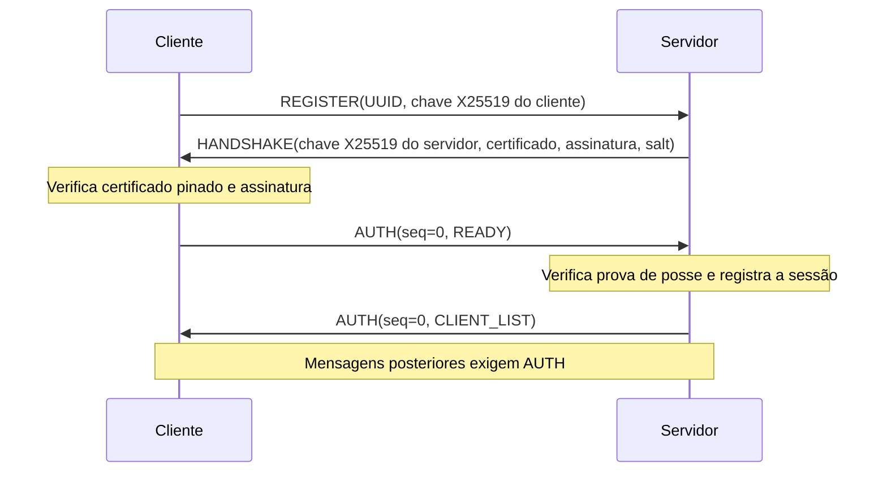

# Protocolo de mensageria — versão 1

Estado: implementado e integrado em 03/11/2026. Este documento substitui a proposta inicial. As interpretações assumidas sem resposta do professor estão no [relatório do Dev A](relatorio-progresso-dev-a.md).

## 1. Transporte e representação

Cada corpo de mensagem é JSON UTF-8 com prefixo de quatro bytes unsigned big-endian. O prefixo indica somente o tamanho do corpo. O limite é de 1 a 65.536 bytes. O receptor usa leitura exata; EOF entre quadros encerra a conexão normalmente. Cabeçalho parcial, corpo parcial, comprimento zero ou excessivo causam rejeição.

UUIDs usam texto canônico UUIDv4 no JSON e 16 bytes na transcrição e no quadro E2E. Chaves públicas X25519 usam 32 bytes raw. Campos binários no JSON usam Base64. Campos JSON repetidos e constantes não finitas são recusados.

O conteúdo do relay continua binário dentro do Base64. Seu limite é de 4.164 bytes decodificados. O servidor valida Base64, limite, sessão e destino; o destinatário interpreta o quadro E2E. O corpo TCP admite o espaço adicional do envelope administrativo e das listas de clientes.

## 2. Handshake e confiança

O certificado X.509 do servidor é provisionado no cliente antes da conexão. Ele contém a chave pública RSA de identidade. O certificado deve ser autoassinado, estar na validade, usar RSA de pelo menos 2048 bits e SHA256 e permitir assinatura digital. O gerador do projeto usa RSA de 3072 bits e validade de 365 dias. O cliente exige igualdade DER com sua cópia confiável.

O termo `pk_server` representa a chave pública **X25519 efêmera** do servidor nesta conexão. A chave RSA privada assina sua transcrição. O servidor não usa essa chave X25519 para derivar chaves E2E dos pares.



### REGISTER

Campos: `type="REGISTER"`, `client_id` e `client_public_key`. O cliente gera um par X25519 novo em cada conexão. O servidor recusa chaves de ordem baixa durante o acordo X25519. O UUID deve ser exclusivo entre as sessões ativas.

### HANDSHAKE

Campos: `type="HANDSHAKE"`, `version=1`, `server_public_key`, `certificate`, `signature` e `salt`. Os quatro últimos campos são Base64. O servidor gera uma chave X25519 nova por conexão e usa o mesmo `salt_srv` aleatório de 16 bytes para todos os clientes desta execução.

A transcrição tem exatamente 96 bytes:

```text
T = pk_server[32] || pk_client[32] || client_id[16] || salt_srv[16]
h = SHA256(T)
assinatura = RSA-PSS(chave_RSA_privada, h)
```

A assinatura usa SHA256, MGF1-SHA256 e salt PSS de **32 bytes**. `Prehashed(SHA256)` evita um segundo hash de `h`. O salt PSS é interno à assinatura; ele é diferente do `salt_srv` de **16 bytes** usado no HKDF. O cliente monta `T` com sua própria chave pública e seu próprio UUID, e verifica a assinatura com a chave do certificado pinado.

Alterar o registro na rede impede que o cliente valide a resposta correspondente. Antes de anunciar uma sessão, o servidor exige `READY` autenticado, que prova posse da chave X25519. Essa prova não autentica uma pessoa nem uma conta permanente.

### Chaves administrativas

Ambos os lados calculam `Z_SC = X25519(sk_local, pk_remota)` com as chaves efêmeras do handshake. Derivam 64 bytes com HKDF-SHA256:

```text
material = HKDF-SHA256(
    IKM=Z_SC,
    salt=salt_srv,
    info="mensageria-v1/controle/" || SHA256(T),
    L=64
)
K_C2S = material[0:32]
K_S2C = material[32:64]
session_id = hexadecimal(SHA256(T))
```

Essas chaves são exclusivas do controle cliente-servidor e separadas das chaves AES E2E. O servidor não mantém o segredo entre dois clientes.

## 3. Envelope administrativo autenticado

Após `HANDSHAKE`, cada mensagem usa este envelope:

```json
{
  "type": "AUTH",
  "session_id": "<64 caracteres hexadecimais>",
  "seq_no": 0,
  "message": {"type": "READY"},
  "mac": "<Base64 do HMAC-SHA256>"
}
```

O MAC cobre todos os campos do envelope, exceto `mac`. A serialização para o MAC usa `json.dumps` com chaves ordenadas, separadores `,` e `:`, `ensure_ascii=True` e `allow_nan=False`, codificada em ASCII. A representação JSON externa pode conter espaços; ambos os lados recalculam o MAC sobre a forma canônica.

Cada direção possui seu próprio contador unsigned de 64 bits, iniciado em zero. O receptor exige exatamente o próximo número, pois TCP preserva a ordem. Só avança o contador depois de verificar o MAC. Sessão diferente, MAC inválido, repetição, salto ou esgotamento do contador encerram a conexão. O `READY` consome o primeiro contador cliente-servidor. `CLIENT_LIST` consome o primeiro contador servidor-cliente.

Essas mensagens são autenticadas, mas não cifradas. Um observador ainda pode ver identificadores, chaves públicas, tamanhos e eventos. O conteúdo do `RELAY` já está cifrado pelos clientes.

## 4. Mensagens internas após o handshake

| Tipo | Direção | Campos e regra |
| --- | --- | --- |
| `READY` | Cliente → servidor | Somente `type`. Confirma o handshake e precede o registro efetivo. |
| `CLIENT_LIST` | Servidor → novo cliente | `clients`: pares `client_id` e `client_public_key`; não inclui o próprio cliente. |
| `CLIENT_JOINED` | Servidor → clientes existentes | `client_id`, `client_public_key`. Um peer ainda ativo não pode ser reinserido sem saída anterior. |
| `CLIENT_LEFT` | Servidor → clientes restantes | `client_id`. Remove o estado E2E desse peer. |
| `RELAY` | Cliente → servidor | `recipient_id`, `payload`. O remetente é obtido da sessão autenticada. |
| `RELAY` | Servidor → destinatário | Acrescenta `sender_id`; mantém o mesmo `payload`. |
| `ERROR` | Servidor → remetente | `code="UNKNOWN_CLIENT"` quando o destino saiu ou falhou durante a escrita. A conexão do remetente continua ativa. |

Não há comando `DISCONNECT`: o fechamento TCP faz a remoção. Erros de framing, JSON, autenticação, ID duplicado ou mensagens fora da ordem causam fechamento. Dados inválidos não recebem um erro detalhado pela rede. Os logs incluem motivos técnicos fixos, sem conteúdo ou segredos.

A trava do registro ordena listas, entradas e saídas. A trava de cada sessão ordena seus envios e contadores. Há limite de 128 clientes registrados, prazo de 10 segundos para o handshake e 5 segundos por escrita. O serviço permanece uma implementação acadêmica; esses limites não constituem proteção completa contra negação de serviço.

## 5. Conteúdo E2E preservado da implementação do Dev B

```text
nonce[12] || sender_id[16] || recipient_id[16] || seq_no[8] || ciphertext || tag[16]
```

O quadro mínimo tem 68 bytes; o máximo tem 4.164 bytes. O texto claro tem até 4.096 **bytes**, não caracteres. AES-128-GCM usa chaves de 16 bytes.

```text
nonce = IV_base[4] || seq_no[8, big-endian]
AAD   = sender_id[16] || recipient_id[16] || seq_no[8, big-endian]
```

Para cada par, ambos calculam `Z_AB = X25519(sk_local, pk_peer)`. O cliente de menor UUID em bytes é o lado A do par. Esse A não significa o integrante Dev A.

```text
PRK     = HMAC-SHA256(salt_srv, Z_AB)
Key_A2B = HKDF-Expand(PRK, info="A2B", L=16)
Key_B2A = HKDF-Expand(PRK, info="B2A", L=16)
```

Cada direção tem IV base aleatório e contador próprio, iniciado em zero. O envio consome o contador ao montar o quadro, antes da escrita. Uma falha de rede não permite reutilizar o quadro com o mesmo contador para cifrar outro texto.

O recebimento exige IDs corretos, nonce consistente com a sequência, IV base constante e sequência maior que a última aceita. Depois, verifica a tag GCM. Só após autenticar atualiza o contador e aprende o IV base do primeiro quadro. Falha de autenticação E2E ou replay produz evento `rejeitada`; o cliente pode continuar recebendo quadros válidos.

O remetente no JSON deve coincidir com o remetente autenticado dentro do quadro. A sequência E2E é independente da sequência do envelope administrativo. O relay não decifra e não controla a sequência E2E.

## 6. Desconexão, reconexão e confiança no diretório

Fechar remove a sessão e informa os outros clientes. A reconexão gera nova chave X25519 do cliente e do servidor, novo handshake, novos canais de controle e novas chaves E2E. Isso também ocorre ao reutilizar a mesma instância de `Cliente`, depois de encerrar a escuta anterior.

O salt é compartilhado pela execução do servidor e muda ao reiniciá-lo. Dentro da mesma execução, ele pode ser reutilizado com segredos ECDH novos. Essa é a interpretação adotada para conciliar distribuição multiparte e renovação de chaves. Nunca se reutilizam os pares de chaves efêmeras da conexão anterior.

O cliente só usa chaves de peers recebidas no canal autenticado. O servidor é a autoridade confiável desse diretório. Um servidor comprometido com a chave RSA ainda pode substituir chaves; resistir a isso exigiria uma identidade independente de cada usuário. O protocolo não inclui cadastro, histórico persistente, recuperação de mensagens ou identificação de pessoas.
